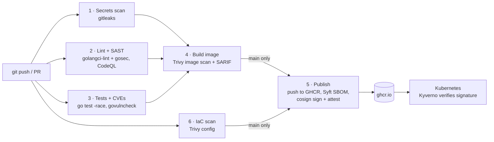

# secure-ship

A reference DevSecOps pipeline: how to ship a service from commit to
Kubernetes with security checks at every step.

The service itself is a small Go URL shortener. It is deliberately simple so
the focus stays on what surrounds it: the CI pipeline, the container image,
the Kubernetes manifests and the admission policies.

## The problem

Most breaches in delivery pipelines do not need a zero-day. They use what is
already lying around: a credential committed to git, a base image with a known
CVE, a container running as root, a cluster that will run any image it is
given. Each of these has a well-known, free control. This repository wires
those controls together end to end, so every artifact that reaches the
cluster has been scanned, is traceable to a commit, and is signed by the
pipeline that built it.

## Pipeline



| Stage | Job | Fails the build when |
|---|---|---|
| 1 | Secrets scan | gitleaks finds a secret anywhere in git history |
| 2 | Lint + SAST | golangci-lint/gosec reports an issue; CodeQL results go to code scanning |
| 3 | Tests + CVEs | a test fails (with `-race`), or govulncheck finds a reachable vulnerable function |
| 4 | Build + image scan | the image has a HIGH/CRITICAL CVE with a fix available |
| 5 | Publish (main only) | push, signing or attestation fails |
| 6 | IaC scan | rendered manifests or the Dockerfile have a HIGH/CRITICAL misconfiguration |

The image is built **once** in stage 4, saved as a tarball and pushed by stage
5, so the image that was scanned is byte-for-byte the image that ships. The
workflow starts with `permissions: {}` and each job requests only what it
needs; only the publish job can write packages or request an OIDC token.

## Security controls

| Control | Threat mitigated | Tool / where |
|---|---|---|
| Secret scanning (pre-commit + CI, full history) | Credentials leaked through git | gitleaks |
| Static analysis | Injection, weak crypto, unchecked errors, unsafe HTTP use | golangci-lint + gosec, CodeQL |
| Reachability-based dependency scanning | Exploitable CVEs in Go modules and stdlib | govulncheck |
| Image vulnerability scan, results in code scanning | Known CVEs in OS packages and binaries | Trivy + SARIF upload |
| Distroless, static, non-root image | Post-exploitation tooling (no shell, no package manager), privilege escalation | Dockerfile, `distroless/static:nonroot` |
| SBOM attached to the image | Unknown contents; slow response to the next Log4Shell | Syft (SPDX), `cosign attest` |
| Keyless signing | Tampered or unofficial images in the registry | cosign + GitHub OIDC + Fulcio/Rekor |
| Admission signature verification | Running images not built by this pipeline | Kyverno `verify-image-signature` |
| Admission guardrails | `:latest` drift, root containers, unbounded resource use | Kyverno policies, Pod Security `restricted` |
| Hardened pod spec | Container breakout, writes to the filesystem, API token theft | `securityContext`, `automountServiceAccountToken: false` |
| Default-deny NetworkPolicy, no egress | Lateral movement, data exfiltration | `deploy/k8s/base/networkpolicy.yaml` |
| IaC misconfiguration scan | Insecure manifests merged unnoticed | Trivy config on rendered overlays |
| Least-privilege CI tokens | A compromised step abusing `GITHUB_TOKEN` | per-job `permissions:` |
| Input validation | Open redirect to `javascript:`/`data:` URLs, phishing via `user@host`, redirect loops | `internal/api/validate.go` |
| Rate limiting, body/header limits, server timeouts, store capacity | Brute force, resource exhaustion, Slowloris | `internal/middleware`, `cmd/server` |
| Security headers | Clickjacking, MIME sniffing, referrer leakage | `internal/middleware` |

## Threat model (STRIDE-lite)

Assets: the image in the registry, the running pods, the stored links.
Trust boundaries: developer → GitHub, GitHub Actions → GHCR, GHCR → cluster,
internet → service.

| Threat | Example | Mitigation | Residual risk |
|---|---|---|---|
| **S**poofing | Attacker pushes their own image to GHCR with a stolen token | Kyverno only admits images signed by this repo's `main` workflow | An attacker who can merge to `main` can get code signed; protect `main` with reviews |
| **T**ampering | Tag `sha-abc` re-pointed to a different image | Prod deploys by digest; Kyverno `mutateDigest` pins tags to the verified digest | Base images are pinned by tag, not digest (see roadmap) |
| **T**ampering | Malicious dependency or compromised GitHub Action | `go mod verify`, govulncheck, small dependency set, actions pinned to versions | Third-party actions are pinned by tag, not commit SHA |
| **R**epudiation | "Who built and released this image?" | Rekor transparency log entry ties signature to workflow run and commit | Logs of the service itself are stdout only |
| **I**nformation disclosure | Secret committed and pushed | gitleaks in pre-commit and CI over full history | A secret pushed once must still be rotated |
| **I**nformation disclosure | Compromised pod reads cluster secrets | No service account token, no egress, read-only root filesystem | — |
| **D**enial of service | Flooding `POST /api/links` to fill memory | Per-IP rate limit, 4 KiB body limit, `MAX_LINKS` cap, resource limits, HPA | Behind a proxy all clients share one IP (see limitations) |
| **E**levation of privilege | Container breakout after RCE | Non-root UID 65532, all capabilities dropped, no privilege escalation, seccomp `RuntimeDefault`, PSA `restricted` | Kernel vulnerabilities |

## Repository layout

```
cmd/server/            entrypoint: config, wiring, graceful shutdown
internal/api/          HTTP handlers and input validation
internal/store/        Store interface + in-memory implementation
internal/middleware/   rate limiting, security headers, logging, panic recovery
deploy/k8s/            Kustomize base + dev/prod overlays
deploy/policies/       Kyverno ClusterPolicies
.github/workflows/     the pipeline
```

## Run locally

Requires Go 1.25+.

```sh
make run        # or: go run ./cmd/server
make test       # unit tests with -race and coverage
make lint       # gofmt, go vet, golangci-lint (if installed)
make scan       # gitleaks, govulncheck, trivy config (each if installed)
make k8s        # render both Kustomize overlays
make image      # docker build (requires Docker)
```

Configuration is by environment variable:

| Variable | Default | Meaning |
|---|---|---|
| `ADDR` | `:8080` | listen address |
| `BASE_URL` | `http://localhost:8080` | public URL used to build short links |
| `RATE_LIMIT_RPS` / `RATE_LIMIT_BURST` | `5` / `10` | per-client token bucket |
| `MAX_LINKS` | `100000` | store capacity |
| `SHUTDOWN_DELAY` | `5s` | time between failing `/readyz` and closing the listener |

Try it:

```sh
# create a link
curl -s -X POST localhost:8080/api/links \
  -H 'Content-Type: application/json' \
  -d '{"url":"https://go.dev/doc/"}'
# {"code":"omWXn8y","short_url":"http://localhost:8080/omWXn8y","url":"https://go.dev/doc/"}

curl -si localhost:8080/omWXn8y | head -3        # 302 Found, Location: https://go.dev/doc/
curl -s  localhost:8080/api/links/omWXn8y        # {"code":"omWXn8y",...,"hits":1}

# validation
curl -s -X POST localhost:8080/api/links -H 'Content-Type: application/json' \
  -d '{"url":"javascript:alert(1)"}'               # {"error":"url scheme must be http or https"}

# rate limit: after the burst, requests get 429 Too Many Requests
for i in $(seq 15); do curl -s -o /dev/null -w '%{http_code} ' localhost:8080/api/links/omWXn8y; done
```

`/healthz` (liveness) and `/readyz` (readiness) are not rate limited. On
`SIGTERM` the server fails `/readyz`, waits `SHUTDOWN_DELAY` so Kubernetes
removes it from the Service endpoints, then drains in-flight requests.

## Deploy

```sh
kubectl apply -f deploy/policies/          # requires Kyverno >= 1.13
kubectl apply -k deploy/k8s/overlays/dev
```

Set the image first: dev uses the `sha-<commit>` tag, prod uses the digest
printed in the publish job summary:

```sh
cd deploy/k8s/overlays/prod
kustomize edit set image ghcr.io/rakaprad/secure-ship@sha256:<digest>
```

The NetworkPolicy allows traffic only from the `ingress-nginx` namespace;
change the selector if your ingress controller lives elsewhere.

## Verify a signed image

Install [cosign](https://docs.sigstore.dev/cosign/system_config/installation/),
then check that the image was signed by this repository's pipeline on `main`:

```sh
IMAGE=ghcr.io/rakaprad/secure-ship@sha256:<digest>

cosign verify "$IMAGE" \
  --certificate-identity https://github.com/rakaprad/secure-ship/.github/workflows/pipeline.yml@refs/heads/main \
  --certificate-oidc-issuer https://token.actions.githubusercontent.com
```

Verify and read the SBOM attestation:

```sh
cosign verify-attestation "$IMAGE" --type spdxjson \
  --certificate-identity https://github.com/rakaprad/secure-ship/.github/workflows/pipeline.yml@refs/heads/main \
  --certificate-oidc-issuer https://token.actions.githubusercontent.com \
  | jq -r '.payload' | base64 -d | jq '.predicate.packages[].name'
```

Verification fails if the image was signed by any other repository, workflow
file or branch. The pipeline signs with the classic (non-bundle) signature
format because Kyverno `ClusterPolicy` image verification reads it reliably
on registries without the OCI 1.1 referrers API.

## Known limitations

These are deliberate trade-offs to keep the project small:

- **The store is in memory and per pod.** With more than one replica, a link
  created on one pod is not visible on another. The prod overlay (HPA,
  2+ replicas) assumes a shared store, which is on the roadmap.
- **Rate limiting uses the TCP peer address.** `X-Forwarded-For` is ignored
  because clients can forge it. Behind an ingress, all clients share the
  ingress controller's IP; a trusted-proxy setting is on the roadmap.
- **No TLS in the service.** TLS is expected to terminate at the ingress.
- **No authentication.** Anyone who can reach the API can create links.

## Roadmap

- Redis or Postgres `Store` implementation so replicas share data
- Trusted-proxy configuration for client IP extraction
- Pin base images and third-party actions by digest / commit SHA, kept fresh by Renovate
- SLSA build provenance attestation and a Kyverno rule that requires it
- Kyverno rule that requires the SBOM attestation, not just the signature
- OpenSSF Scorecard and `zizmor` (GitHub Actions static analysis) in CI
- Migrate to Kyverno `ImageValidatingPolicy` and the Sigstore bundle format
- Prometheus metrics and an OpenTelemetry trace exporter

## License

[MIT](LICENSE) © 2026 Raka Pradipta
